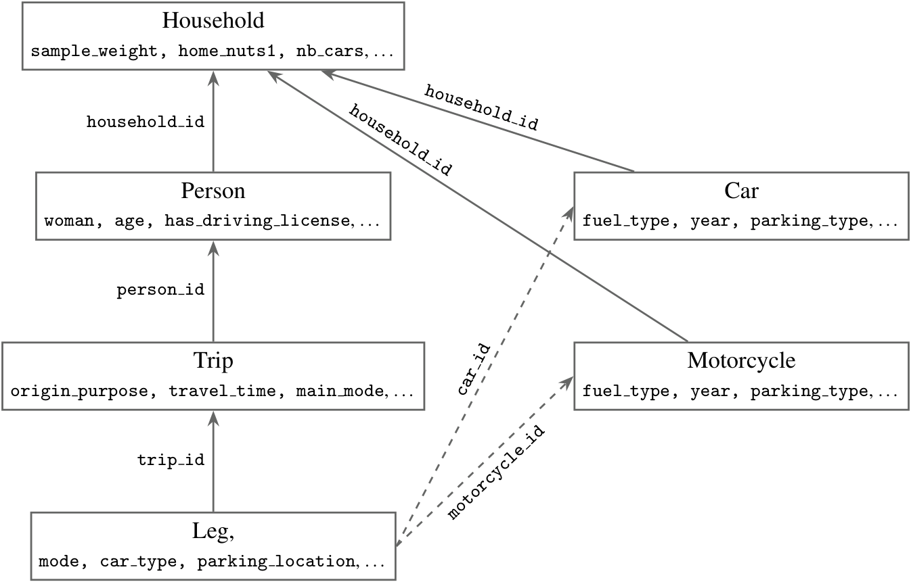

# Format Specification

A survey standardized by Nemobi consists in the following files stored within a directory:

- [`metadata.json`](./metadata.html): general information on the survey
- [`households.parquet`](./households.html)
- [`persons.parquet`](./persons.html)
- [`trips.parquet`](./trips.html)
- [`legs.parquet`](./legs.html)
- [`cars.parquet`](./cars.html)
- [`motorcycles.parquet`](./motorcycles.html)
- [`special_locations.geo.parquet`](./zones.html) [optional]
- [`detailed_zones.geo.parquet`](./zones.html) [optional]
- [`draw_zones.geo.parquet`](./zones.html) [optional]

The diagram below shows the relationships between the main entities in Nemobi.

